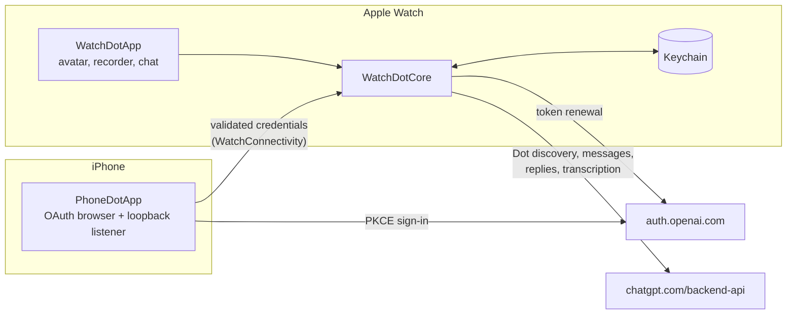
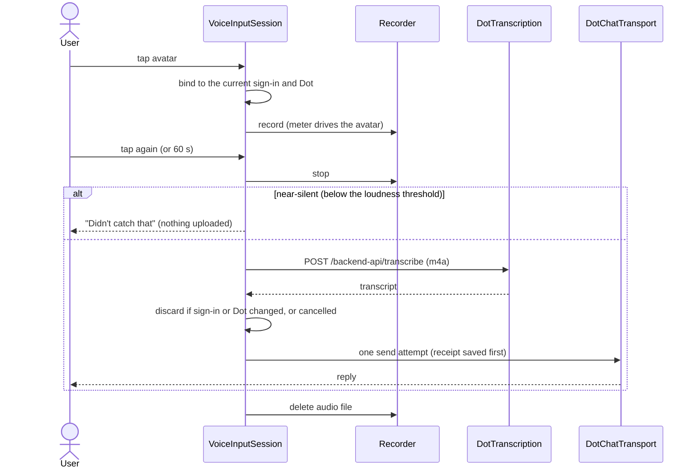

# Architecture

The iPhone is needed only for sign-in. After that the Watch renews its own session and talks to
the Dot directly over Wi-Fi or cellular.

## Targets

| Target | Role |
|---|---|
| `WatchDotPhone` | iPhone companion. Runs the browser sign-in, owns the loopback listener, and hands validated credentials to the Watch. Embeds the Watch app. |
| `WatchDot` | Watch app: the avatar home screen, the Options menu (Type a Message, History, Change Avatar, Settings), the full-screen reply reader and voice capture. |
| `WatchDotComplication` | Watch face launcher. |
| `WatchDotCore` | Swift package shared by the apps, with the XCTest suite. |

## WatchDotCore

| File | Responsibility |
|---|---|
| `Authentication.swift` | OAuth PKCE flow, `SecureSignInHTTP` (HTTPS only, no redirects, size caps, challenge detection), Keychain store |
| `OpenAIIdentityVerifier.swift` | ID token verification against the published JWKS |
| `CompanionAuthentication.swift`, `CompanionConnectivity.swift` | Typed iPhone-to-Watch sign-in envelopes over WatchConnectivity |
| `LoopbackCallback.swift` | Strict parsing of the loopback OAuth callback |
| `ConnectionSession.swift` | Sign-in state, single-flight token renewal, Dot discovery, voice wiring |
| `DotAccessProbe.swift` | Locates the account's primary Dot and its room |
| `DotChatTransport.swift` | Sends with a persisted receipt and idempotency token; confirms delivery by request ID; waits for replies |
| `RoomReception.swift` | Paged message reception |
| `Conversation.swift` | Conversation state, local snapshot store, demo transport |
| `DotTranscription.swift` | Multipart upload to the dictation endpoint and strict response decoding |
| `VoiceInputSession.swift` | Voice state machine: permission, recording, transcription, a single send, cancellation |
| `AvatarAnimation.swift` | Sprite rows, frame timings and motion policy |
| `AvatarPresentation.swift` | Which reply the reader shows. Only runtime arrivals open it, never history loading or replies already dismissed, and only when no recording, menu or sheet is active. |
| `CompanionAppearance.swift` | Local avatar choice (sprite, Pebble, Orbit, Pixel), independent of the account and the Dot |

## Watch app

| File | Responsibility |
|---|---|
| `AvatarConversationView.swift` | Home screen: avatar, status line, idle "Tap to speak", Options menu, reply queue |
| `ReplyReaderView.swift` | Full-screen scrollable reply with Done and back-to-avatar; text hidden in Always On |
| `AvatarPickerView.swift` | Vertical paging picker with Choose and Selected |
| `CompanionAvatar.swift`, `SpriteAvatar.swift` | Glyph avatars and the optional sprite, driven by the microphone level |
| `WatchVoiceRecorder.swift` | AVAudioRecorder capture (AAC, mono), metering, file cleanup |
| `WatchDotApp.swift` | App entry and the upstream text chat, now reached from the Options menu |

## Voice turn

## Invariants

- **Duplicate risk is reduced, not ruled out:** one request per attempt, with one client turn ID
  saved as a receipt before the request. Recovery after an uncertain outcome is read-only
  (matching by request ID); a resend needs an explicit retry. Server-side deduplication is not
  assumed.
- **No automatic replay:** neither audio uploads nor uncertain sends are retried automatically.
- **Late results are dropped:** a result arriving after cancellation, a sign-out or a change of
  Dot is discarded.
- **Fixed error messages:** users never see response bodies, tokens or account identifiers.
- **Cosmetic avatar choice:** it is stored locally and never affects routing.
- **Replies never interrupt:** a reply never opens during a recording, a menu or a sheet, and
  closes only on an explicit action.

## Experimental endpoints

Dot discovery, messaging and dictation use non-public, undocumented `chatgpt.com/backend-api`
routes. OpenAI does not support them, and they can change or be blocked at any time. The client
keeps them behind `DotAccessProbe`, `DotChatTransport` and `DotTranscription`, and treats unexpected
responses as fixed errors.
